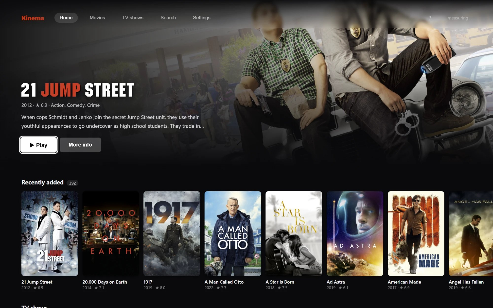
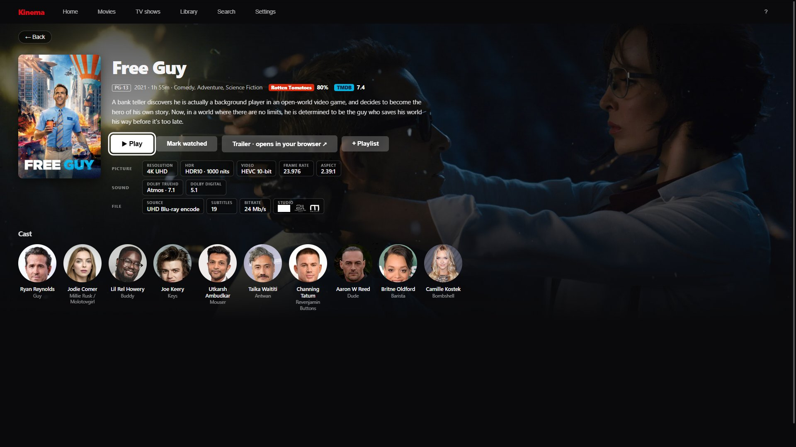
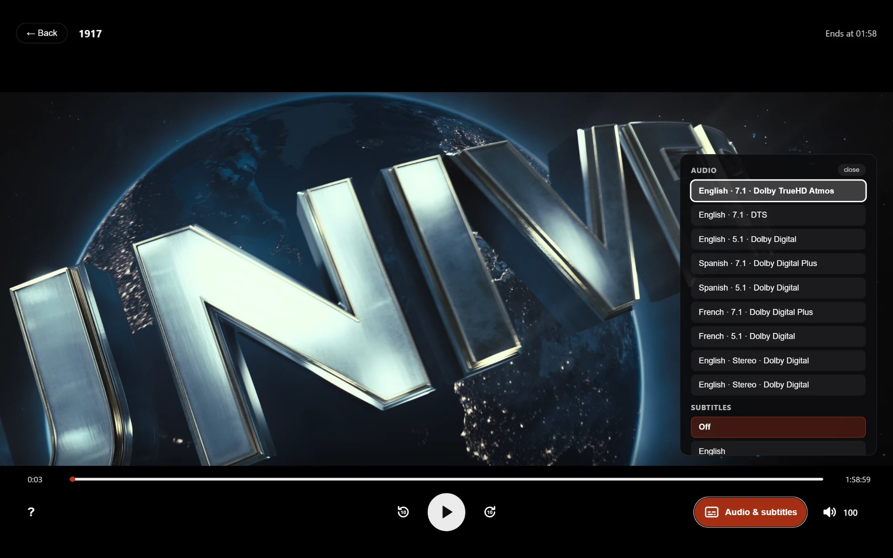
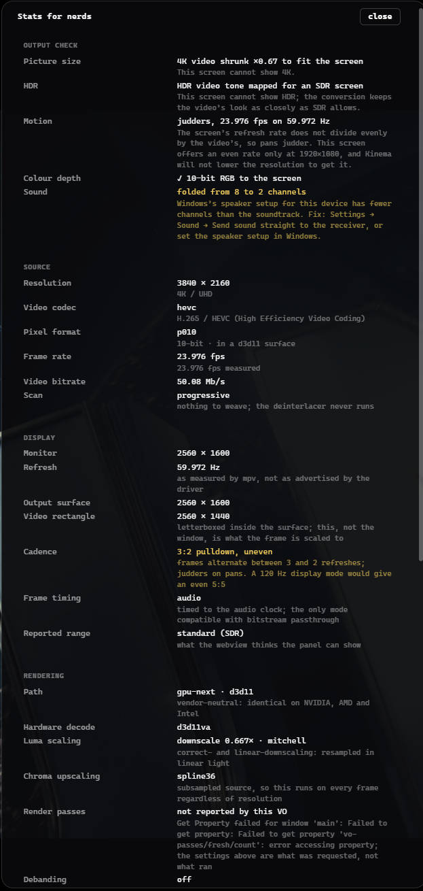

# Kinema — a free local media library and video player for Windows, Linux and Android TV

[](https://github.com/Basswaves/kinema/releases/latest)
[](https://github.com/Basswaves/kinema/actions/workflows/ci.yml)
[](LICENSE)

**Netflix-style browsing for the movies and shows already on your disk or NAS,
with the picture and sound set up right for your own screen and speakers — and
no server, no account and no settings maze.** One free, open-source program for
Windows 11, Linux and Android TV boxes, used with a mouse, a keyboard or a TV
remote. Close it and nothing is left running.

**[Download](https://github.com/Basswaves/kinema/releases/latest)** for
**Windows 11** (an installer or a ZIP), **Linux** (`.deb`, `.rpm` or a folder,
x86-64 and ARM) or **Android TV** (an early version, installed by hand) ·
[Install](#install) · [What it does](#what-it-does) ·
[Platform support](#platform-support) ·
[Give feedback](#testing-it-and-giving-feedback) ·
[Website](https://basswaves.github.io/kinema/)



## Why Kinema

Most people who keep their own video files end up choosing between three kinds
of program, each good at one thing:

- **VLC and MPC-HC play anything and just work**, which is why so many people
  never leave them. But what you get is a file browser with a player in it: no
  posters, no "continue watching", no next episode, no Skip intro — none of the
  niceties of a modern streaming app.
- **Kodi** needs no server, plays almost anything and can be tuned to do exactly
  what you want, which is why enthusiasts love it. The flip side: it can be
  clunky to find your way around, its many settings are a lot for a newcomer,
  and the best-looking skins are heavy, so they can make it sluggish, most of
  all on a modest PC or a TV box.
- **Plex and Jellyfin** look the part and close the gap, but only once a server
  is running somewhere and somebody keeps it maintained.

Kinema is the one in between: the library and polish of a streaming app, the
"press play and it works" of VLC, and no server. It is a single program that
looks good out of the box, with nothing to host, skin or maintain. Its
interface is part of the program rather than a skin on top of one, and it eases
off its own effects on weaker hardware, so it stays quick on a TV box as well
as a big PC.

## It sets itself up

Getting a film to look and sound right at home depends on things most people
have never heard of: whether the screen switches to the film's 24 frames a
second or shows it with judder, whether HDR is on, which sound formats the
receiver can take untouched, which subtitles should show. Enthusiasts spend
hours on this in MPC-HC or Kodi. Everyone else never does, and gets a picture
or sound that is a little wrong without ever knowing.

Kinema asks your equipment what it can do, and sets things up from the answer:

- **The screen matches the film**: its refresh rate for smooth 24p, and HDR
  switched on for an HDR film.
- **Atmos, DTS:X and TrueHD go to a receiver untouched**, when the receiver
  takes them.
- **Subtitles in your language** when the sound is in another, and none when it
  is not.
- **A film is never matched to the wrong title.** When Kinema is not sure, it
  puts the file aside for you to check instead of guessing.

You answer a few plain questions once, on the first run, each with what it
gives and what it costs, and each skippable. If you know what all this means,
the setup is the part you get to skip, and the details are one key away: press
`i` while watching to see the display's real refresh rate, the frame cadence,
which scaler ran and why, and the colour pipeline end to end. It reports
rather than flatters.

There is no quality preset to fiddle with, on purpose: the right choice depends
on the film and the screen, and Kinema already knows both. Nothing is invented
either. No machine-learning upscaling that makes up detail the master never
had, and no frame interpolation that makes up frames.

## Is it for you?

**Yes, if** you keep your own movies and shows as files — on a PC, a laptop
plugged into the TV, a Linux box or an Android TV box — and want them to look
and sound right without it becoming a project:

- **You never wondered what a refresh rate or a sound format has to do with a
  film**, and you should not have to. Kinema sets it up, so the picture and the
  sound are what the film's makers meant, on the equipment you have.
- **You know exactly what they are**, have spent evenings in a config file for
  them, and would rather have them just work. Kinema does what you would have
  configured, shows its working when you press `i`, and gives the evenings back.

**Probably not, if you want:**

- **Your library on every screen in the house, or on the road.** With no server,
  a film plays on the device Kinema runs on. Several devices can read the same
  NAS, but each keeps its own library and its own place in a film.
- **Streaming-service apps or an add-on store.** Kinema plays the files you own.
  Keeping that kind of thing working is a job of its own, and Kinema is built to
  run for years without one.
- **A tuning bench.** If you enjoy comparing upscalers and writing shader
  chains, Kinema takes those decisions away on purpose: no quality presets, no
  machine-learning upscaling, no frame interpolation. What is in the film is
  what is shown.
- **Apple TV, iPhone or iPad.** Not planned. A Mac version is possible one day,
  with no promise attached.
- **Something to pay for.** Kinema is free and open source, and will stay that
  way: no premium tier, no subscription, no "unlock 4K" button. If paying is how
  you know software is good, we are sorry; there is nobody to hand the money to.

## Who makes it

Kinema is built by one person together with Claude, Anthropic's AI coding
assistant, which writes the code under the author's direction; the author
decides what Kinema is, and what it deliberately is not. A project made that
way has to earn trust differently, so the checking is out in the open:

- Automated tests run on every change, on Windows and Linux (x86-64 and ARM).
- Scripts run the real app and the real player through scripted sessions, not
  just the parts in isolation.
- Every design decision is written down with its reasons
  ([docs/HISTORY.md](docs/HISTORY.md)), and so is every trap found along the
  way ([docs/GOTCHAS.md](docs/GOTCHAS.md)).
- It is MIT-licensed and all of it is here to read.

It is an early project, and tested on a small number of setups.
[Reports from yours](#testing-it-and-giving-feedback) — working or not — are
what shapes it.

## Try it

1. Download the file for your system from the
   [Releases](https://github.com/Basswaves/kinema/releases/latest) page and open
   it ([Windows](#install), [Linux](#linux), [Android](#android)).
2. Answer two questions — where you will watch, and which folder your films are
   in. A local drive, a USB drive and a NAS share all work.
3. Press **Scan my library**. Posters and descriptions arrive by themselves;
   anything Kinema is not sure about is put aside for you to check, never
   guessed.

Nothing to sign up for, nothing left running, nothing written to your media.
It is an early project made by one person: if something misbehaves on your
equipment, [tell us](#when-something-goes-wrong) — that is how it gets better.



Detail pages carry the cast, the description and — for a series — every season
and episode, opening on the season you are in, with progress on the ones you
have started. Under the buttons, badges say what the file really holds — for a
series, what the season on screen holds, and which episodes differ — and
beside the year are its age rating and its IMDb, Rotten Tomatoes and TMDB
scores. Posters everywhere show what you have watched.



A remote works the way it does on any streaming app: **OK** pauses, **←/→**
seek (hold to go faster), and **↑/↓** bring up the controls — the seek bar,
audio and subtitles, volume. Back steps back to wherever you came from.

## What it does

- **Finds your movies and shows** by walking folders you nominate. It never reads
  file contents to identify them, so scanning a NAS stays cheap.
- **Fetches posters, backdrops, descriptions, cast and episode stills**, and
  caches them locally so browsing works with no connection.
- **Refuses to guess.** A match it is not confident about goes to a review queue
  with the reason, rather than silently attaching the wrong movie to your file —
  and Home tells you when something is waiting there.
- **Plays through mpv** — the same engine as the standalone player — with
  hardware decoding, HDR tone mapping, PGS subtitles and 4K remuxes. On
  Android it plays through Android's own media player (Media3) instead, which
  takes Dolby Vision and sound for a receiver straight from the system.
- **Reads from a NAS or a USB drive** as easily as from a local disk: SMB
  shares are browsed and signed in to from inside Kinema, and a share that is
  switched off is left alone rather than treated as an empty library.
- **Says what each file really holds.** A title's page shows the resolution,
  the Dolby Vision profile — with FEL or MEL — and HDR format, the exact sound
  format (TrueHD Atmos, DTS:X, DD+ Atmos), frame rate, bit depth and the aspect
  ratio measured from the picture itself, so a 2.39:1 film in a 16:9 file says
  2.39:1. Where it came from (UHD Blu-ray remux, WEB-DL…) is read from the
  release name; nothing else is.
- **Keeps home videos and clips apart.** A Videos folder holds what is neither
  a film nor a show, never matched, each with a picture taken from the file,
  under the Library tab. Library → Folders browses your drives and shares
  inside Kinema and plays any video in them.
- **Remembers where you were**, per file, and offers the next episode.
- **Tells SIMKL and Trakt what you watched**, if you connect them: whatever you
  finish in Kinema is added to your account. Connecting is a code on screen and a
  tap on your phone. With Trakt connected, Kinema also continues where you
  stopped on another device (a switch in Settings turns it off); SIMKL only
  receives.
- **Keeps a safety copy** of your watch history, resume points and hand-made
  matches once a week, and puts one back from Settings if the library is ever
  damaged.
- **Skips intros, recaps and credits**, from two community databases, from
  chapter markers, or by fingerprinting a season's audio and finding what the
  episodes share. Where a film has a scene after its credits, Skip takes you
  straight to it.
- **Works from a sofa.** Browsing, searching (with an on-screen keyboard),
  playing, subtitles and resume all work with a D-pad, and the TV layout fills
  the screen with bigger text.
- **Speaks your language.** Subtitles in your language when the audio is in
  another, and none when it is not — set once, remembered per show when you
  change it. Forced subtitles, for the lines in yet another language, show
  even with subtitles off.
- **Finds subtitles online** when a file has none in your language: one press
  in the player takes the best from OpenSubtitles — one made for your exact
  file when there is one — and the rest are a list away. It can also fetch
  forced subtitles by itself.
- **Gets the most out of your equipment.** Atmos and DTS:X untouched, 24p
  without judder, HDR switched on for an HDR film — for every TV and receiver
  that can, only the ones you choose, or none, so a laptop can behave one way
  at a home cinema and another at a desk. The first run asks; Home says when
  something connected can do more than you have chosen.



Press `i` while watching — or choose Playback details at the end of Audio &
subtitles, or a remote's Info key — for what is actually happening: the display's real
refresh rate, the frame cadence, which scaler ran and why, and the colour
pipeline end to end. It reports rather than flatters — the cadence line above is
telling the truth about 24p on a 60 Hz panel.

It reads [NFO sidecar files](docs/DESIGN.md) if you have them, from MediaElch,
tinyMediaManager or Kodi, and treats them as authoritative.

## Install

Everything is on the [Releases](https://github.com/Basswaves/kinema/releases)
page: an installer and a ZIP for Windows, packages for Linux ([below](#linux)), and an `.apk`
for Android TV ([below](#android-early-version)).

On Windows you can use either file:

- **The installer** (`kinema-<version>-windows-x64-setup.exe`) installs Kinema
  for your own Windows account only, so it does not ask for an administrator.
  It adds a Start menu entry and a desktop shortcut, and lists Kinema in
  Settings → Apps. If Windows lacks Microsoft's WebView2 (most have it), the
  installer fetches it from Microsoft. To remove Kinema, use Settings → Apps.
  That removes the program, the shortcuts and the "Offer Kinema as a video
  player" entries in Windows. It then asks, with a box you must tick, whether
  to delete your library and settings too; left unticked, they stay. Installing
  a newer version over it keeps everything.
- **The ZIP** needs no installing: extract it anywhere and run `kinema.exe`. It
  is a folder, and deleting the folder removes it (use Settings → Playback →
  Remove first if you added Kinema as a video player).

### Windows will ask once whether to run it

The first time you open the installer or `kinema.exe`, Windows shows a blue box: **"Windows
protected your PC"**. Click **More info**, then **Run anyway**. Windows
remembers, and does not ask again.

It says that because Kinema is not *code-signed* — signed with a paid
certificate that tells Windows who made the program. That is all it means. It
is the same box for any small program from an independent developer, and it is
not a warning that something was found.

You should not have to take that on faith, so every release publishes a
checksum beside the installer and the ZIP. To check the file you downloaded is
the one that was published, run this in PowerShell in your Downloads folder and
compare the result with the one on the release page:

```powershell
Get-FileHash .\kinema-*-windows-x64-setup.exe -Algorithm SHA256
Get-FileHash .\kinema-*-windows-x64.zip -Algorithm SHA256
```

Kinema asks GitHub for the latest version number when it starts, and says in
Settings when a newer one is out. It never downloads or installs anything by
itself — you download the new installer or ZIP when you choose to.

### Linux

Since 0.8.0, each release has a `.deb`, an `.rpm` and a `.tar.gz` folder,
for x86-64 and for ARM, each with a checksum beside it. Kinema uses your
system's mpv and WebKitGTK; the packages have the package manager install
them:

```bash
sudo apt install ./kinema_<version>_amd64.deb          # Ubuntu 24.04 or later, Debian 13
```

```bash
sudo dnf install ./kinema-<version>-1.x86_64.rpm       # Fedora
```

Anything else: unpack the folder and run `./kinema`; its README.txt names the
two libraries to install. Updates are as on Windows: Kinema says when there
is one, and you install it when you choose.

**HDR on Linux** needs three things, and Kinema says in its stats panel
(`i`) which one is missing:

- **mpv 0.40 or later** — Ubuntu 26.04, Debian 13, Fedora 43, Arch.
- **A desktop with HDR switched on**, or switched on by Kinema for the film
  (Settings → Picture & sound → Screen): GNOME 48 or later, KDE Plasma 6.4
  or later, Sway 1.12 or later; Hyprland switches it on by itself.
  Cinnamon has no HDR, so there HDR films are converted to SDR.
- **A graphics driver that offers HDR to windows.** NVIDIA: driver 595 or
  later, which supports GeForce RTX 20 and GTX 16 cards onwards; Ubuntu
  26.04 installs 580 unless you choose a newer one under Additional Drivers,
  and GTX 10 cards and older stop at 580, so they cannot show HDR on Linux.
  AMD and Intel: Mesa 25.1 or later — Ubuntu 26.04, Fedora 43 and Arch have
  it; Debian 13 has it in its backports. (Checked with an AMD card on Mesa
  26.0: HDR10 reaches the TV on KDE Plasma.)

Without the driver part the desktop shows HDR, but each film is converted to
SDR before it reaches it. On Hyprland, which switches HDR on by itself for a
full-screen HDR film, add `bitdepth, 10` to the TV's monitor rule: without
it HDR goes out at 8 bits per colour, and smooth gradients show bands.

### Android

Since 0.10.0, as an early version (beta), for Android TV boxes: download
`kinema-<version>-android.apk` from the Releases page, copy it to the device (a
USB stick works) and open it from a file manager. Android asks once to allow
installs from that source, because Kinema is not from an app store. What has
been tried and what is missing is under
[Android (early version)](#android-early-version).

The file is signed with Kinema's own key. To check it is the one that was
published, compare the checksum beside it (`sha256sum -c`), and the certificate
that signed it, which for every Kinema release is:

```text
SHA-256  92f709adbc5b3f64a41e4b31c9c94b28514cd1e389786acd2b2d2274db4dbf67
```

A different certificate means it is not from this project. Android refuses to
update an app with one signed by another key, so a copy built elsewhere has to
be removed first.

## First run

The app opens on a welcome panel that asks two things, each answered in a
press:

- **Where you will watch** — a TV from the sofa gives big text and the whole
  screen, made for a remote; a desk gives a window.
- **Where your videos are.** Point it at where you keep your movies, and
  another at your TV shows if they live somewhere else. Local drives and
  network shares both work. Nothing is moved, renamed or written to — the
  files are only read.

On Android there is no system folder picker on a TV, so Kinema shows its own:
the device's storage, a USB drive, or a network drive (a NAS or a computer's
shared folder, which it signs in to itself). The first time, Android asks to
let Kinema read the files.

Then press **Scan my library**. The first scan takes a few minutes on a large
library, and while it runs Kinema asks the rest on a few short pages, each
one skippable, with **Finish later** to go straight to the library:

- **Picture and sound:** sound straight to a receiver, the screen matched to
  the film, HDR switched on for HDR films — each with what it gives and what
  it costs, for every device that can, only the ones connected now, or off.
  Skipped, everything stays off.
- **Intros and credits:** skip them, or show a Skip button; and whether to
  ask TheIntroDB and IntroDB, which know them from other viewers.
- **Accounts:** SIMKL or Trakt, to keep a record of what you finish, and
  OpenSubtitles.
- **Extras:** [ffmpeg](https://ffmpeg.org), which Kinema uses for intros,
  credits and a title's picture and sound details but does not include — on
  Windows one press installs it for you — and an OMDb key for Rotten Tomatoes
  scores.

Everything on them is in Settings too, and Settings → Library → **Run setup
again** brings the pages back. After the first scan, Kinema scans once at
every start and only looks at what changed.

Posters, descriptions and artwork come from [TMDB](https://www.themoviedb.org),
through a key Kinema carries — there is nothing to sign up for. If you would
rather use a free TMDB key of your own, paste it in Settings → Library. Should
TMDB ever be out of reach, movies are still identified through Wikidata, just
without pictures.

Press **?** at any time — or the **?** button in the top bar — for the full list
of keys and remote buttons.

## Optional extras

None of these are bundled, downloaded or required. Each one adds a feature, and
without it that feature is skipped and everything else carries on. (On Windows,
ffmpeg is the one Kinema can install for you, with a button — see below.)

| | What it adds | Without it |
|---|---|---|
| **[ffmpeg](https://ffmpeg.org/download.html)** | Kinema's own intro and credits detection, by fingerprinting a season's audio; and the picture and sound badges on a title's page — resolution, Dolby Vision, HDR, Atmos, the measured aspect ratio | Intros and credits come from TheIntroDB and chapter markers only; a title's page keeps its source, studio, age rating and scores, without the picture and sound badges |
| **[Skiptro](https://github.com/MikeSiLVO/skiptro-releases)** | A second, well-tuned intro detector that Kinema can run and read | The built-in detector handles it |
| **An [OMDb key](https://www.omdbapi.com/apikey.aspx)** (free) | Rotten Tomatoes scores on a title's page, in Settings → Library. Kinema spends at most half of a free key's daily lookups | IMDb's and TMDB's scores only |

These two are for Windows and Linux; Android has no way to run them, and its
intro skips come from the two community databases below.

**ffmpeg on Windows:** press **Install ffmpeg** — on the first run's Extras
page, Home's ffmpeg notice, or Settings → Intro & credits. Kinema asks Windows'
own app installer, winget, to install the Windows build from
[gyan.dev](https://www.gyan.dev/ffmpeg/builds/) that ffmpeg's site points to
(about 110 MB), for your user only, with no administrator prompt. Kinema finds
it straight away and reads your files with it in the background. It is then a
program of its own: it stays if Kinema is removed, and `winget uninstall
Gyan.FFmpeg.Essentials` removes it. A Windows without winget gets the download
page instead.

Elsewhere — or to use a copy you already have — put ffmpeg on your `PATH`, or
point Settings at it. On Linux the `.deb` and `.rpm` packages recommend it.
Fedora's own `ffmpeg-free` leaves out HEVC and E-AC-3; Kinema says in Settings
what that costs, and RPM Fusion's full `ffmpeg` has them.

Skiptro is configured the same way as a copy of ffmpeg you have, at whatever
path you installed it to — point Kinema at `skiptro.exe`,
the command-line one, not `Skiptro-Desktop.exe`.

**TheIntroDB** and **IntroDB** are on by default and need nothing installed.
They are two separate collections of intro, recap and credits times that viewers
have shared, looked up one episode or film at a time, when you play it. IntroDB
also knows where some films have a scene after the credits, so Skip can take
you straight to it. Only which film or episode it is gets sent — no account, no
key, nothing about you. Turn either off in Settings if you would rather it did
not.

**SIMKL** is off until you connect it, in Settings → Accounts. Kinema then adds
each film and episode you finish to your SIMKL account — and, once, everything
you had already watched in Kinema. It only ever adds: nothing comes back, and
marking something unwatched in Kinema leaves SIMKL alone. You approve Kinema on
SIMKL's own page, so Kinema never sees your password.

**OpenSubtitles** needs nothing to start: "Find subtitles online" in the
player's Audio & subtitles panel allows 5 downloads a day, or 20 with a free
OpenSubtitles account, signed in under Settings → Accounts. What is found is
kept in Kinema's own folder, never beside your videos. Settings → Playback can
also have Kinema fetch forced subtitles by itself for files without them.

**Trakt** works the same way, beside SIMKL in Settings → Accounts, with one
difference: Trakt keeps every play it is sent, so when you connect Kinema first
asks what your Trakt account already has and sends only the rest. A free Trakt
account can be connected to only one app besides Trakt's own. Trakt also gives
back where you stopped a film or episode, so it continues on your other
devices; the newer position wins. Settings → Accounts → Trakt, "Continue where
you stopped on another device", turns that off. SIMKL is only ever sent to.

## Platform support

**Windows 11**, using the WebView2 runtime that ships with it. Nothing else to
install.

**Linux**, since 0.8.0: Ubuntu 24.04 or later, Debian 13 and Fedora through
the packages, other distributions through the folder, on x86-64 and ARM.
Kinema uses the system's own mpv and WebKitGTK. Wayland offers no way to put
Kinema's page over mpv, so on Linux mpv plays in a full-screen window of its
own and draws Kinema's controls over the video itself (docs/HISTORY.md, "The
Linux player"). The equipment check, sound straight to a receiver and screen
switching have been checked on a real TV and receiver with GNOME, KDE Plasma,
Sway and Hyprland, on an NVIDIA and an AMD card; screen switching on
Cinnamon has been checked against Cinnamon's own window manager on a test
screen, not yet on a real TV. Kinema is built to work the same on any
desktop and fall back safely, rather than tested on every one —
see [When something goes wrong](#when-something-goes-wrong).

**Android TV**, since 0.10.0, as an early version (beta): see
[Android (early version)](#android-early-version) for what is tested and what
is missing. macOS is not planned by the author; a port is welcome, and
[CONTRIBUTING.md](CONTRIBUTING.md) ("More than one platform") says how the
code is arranged for one.

| | Windows 11 | Linux | Android (early version) |
|---|---|---|---|
| Builds and passes its tests | ✓ | ✓ | ✓ |
| Library, matching, artwork, accounts | ✓ | ✓ | ✓ |
| Playback, controls, remote keys | ✓ | ✓ | ✓ on one TV box and the emulator |
| Equipment check, sound straight to a receiver | ✓ | ✓ | by Android itself; Kinema shows what Android reports |
| Screen switching (refresh rate, resolution) | ✓ | ✓ on GNOME, Cinnamon, KDE Plasma, Sway, Hyprland and the other wlroots desktops | one switch, "Match the screen to the film" |
| HDR switched on for an HDR film | ✓ | ✓ on GNOME and KDE Plasma, by Hyprland itself, and on Sway 1.12 or later (not yet tried on a real TV); needs a driver that offers HDR ([above](#linux)) | by Android itself |
| Sleep / shut down | ✓ | ✓ where the system allows it without a password (logind) | — |
| Badges on a film's page, intro detection from the audio | ✓ | ✓ | not yet |
| Blu-ray `.m2ts` files | ✓ 1080p and 4K UHD HDR; track languages where the disc's `BDMV` folder is beside the file | plays through mpv, not yet tried with a whole film | 1080p plays; 4K UHD not yet |
| Blu-ray folders (`BDMV`), disc images (`.iso`) | ✓ the main film, with chapters and track languages; no menus | ✓ through the system's mpv | not yet |
| Encrypted Blu-ray discs (AACS, BD+) | not played; Kinema says so | not played; Kinema says so | — |

### Android (early version)

Installed by hand ([above](#android)). It plays through Android's own media
player (Media3) rather than mpv, so Dolby Vision and sound passed straight to
a receiver are Android's to do; Kinema shows what Android reports and, where
sound will not open, falls back rather than not playing. The interface is
always the TV layout, and folders are chosen in Kinema's own browser. It is
made for TV devices; a phone or tablet may run it, but is not designed or
tested for.

**Tested:** one TV box and the Android TV emulator, with a remote — library,
matching, network shares, playback of HDR, Dolby Vision and 1080p `.m2ts`
files, subtitles. **Not yet tested:** other boxes, held keys on the
box and the on-screen keyboard. **Missing:** the badges on a film's page,
intro detection from the audio, and Blu-ray folders, disc images and 4K UHD
`.m2ts` files (Kinema says before Play when a file cannot be opened on the
device). Kinema is built on standard Android and Media3 APIs and falls back
safely rather than being tested on every box; a setup that misbehaves is what
the bug report form is for.

## Building from source

On Windows 11: [Node](https://nodejs.org) 20+, [Rust](https://rustup.rs) with
the MSVC toolchain, and Microsoft C++ Build Tools. (On Linux, the packages to
install and how the playback wrapper is built are in
[CONTRIBUTING.md](CONTRIBUTING.md#building).)

```bash
npm install
```

Fetch the native playback libraries — about 95 MB, never committed:

```bash
npx tauri-plugin-libmpv-api setup-lib
```

That pulls an LGPL build of `libmpv-2.dll` and the plugin's wrapper into
`src-tauri/lib/`. See [NOTICE.md](NOTICE.md) for what that means licensing-wise.

```bash
npm run tauri dev
```

To build the portable app and put a shortcut on the desktop:

```bash
npm run app:build
```

`ffmpeg` on `PATH` is optional for development; without it the intro-detection
tests that need real media are skipped.

See [CONTRIBUTING.md](CONTRIBUTING.md) before changing anything — particularly
[docs/GOTCHAS.md](docs/GOTCHAS.md), which is required reading before touching the
player or D-pad navigation.

## When something goes wrong

Kinema writes two logs to `%APPDATA%\com.kinema.app\logs\` on Windows and
`~/.local/share/com.kinema.app/logs/` on Linux. The quickest way there is
**Settings → Advanced → Developer tools → Open log folder**. On Android there
is no folder to open: the same place has **Share the log**, which sends the log
to an app of your choice, such as mail or a cloud drive.

- **`app.log`** — the app's own messages. The window's own console is
  invisible from outside the app, so this is where its errors go.
- **`mpv.log`** — the player's. This is the authority on anything about video:
  it records what actually happened in the render pipeline, not what was asked
  for.

Attach both to a [bug report](https://github.com/Basswaves/kinema/issues/new?template=bug_report.yml).
They are the most useful thing you can send, and most problems here produce no
visible error at all — only a log line. Say which system, which device or
graphics card, and where the media is (a local disk, a USB drive or a NAS).

On Linux, Kinema is built to work the same everywhere rather than tested on
every desktop, version and driver — there are too many for one person. It
uses the shared standards first and falls back safely: where it cannot ask a
desktop to switch the screen, or a driver offers no HDR, the film still
plays. If your setup still misbehaves, a bug report with the logs, your
distribution, desktop and graphics card is how it gets fixed.

## Testing it and giving feedback

Kinema is tested on a small number of setups, and it is built to fall back
safely where it cannot test, so reports from other equipment are what shapes
what comes next. A question, or a story about how it went, is welcome in
[Discussions](https://github.com/Basswaves/kinema/discussions). Three kinds of
report are welcome through
[Issues](https://github.com/Basswaves/kinema/issues/new/choose):

- **A bug**, with the logs — [bug report](https://github.com/Basswaves/kinema/issues/new?template=bug_report.yml).
- **"I tried it on this device"**, whether it worked or not — especially an
  Android TV box, a different TV or receiver, another Linux desktop,
  or a very large library —
  [device report](https://github.com/Basswaves/kinema/issues/new?template=device_report.yml).
  A report that says "works" is as useful as one that says "broken".
- **An idea**, as a [feature request](https://github.com/Basswaves/kinema/issues/new?template=feature_request.yml).
  Read the settled decisions in [CONTRIBUTING.md](CONTRIBUTING.md) first: some
  things are deliberately not done, and the reasons are written down.

Code and documentation changes are welcome too; [CONTRIBUTING.md](CONTRIBUTING.md)
says how to build, check and submit one. Anything exploitable goes to
[SECURITY.md](SECURITY.md), not a public issue.

## Known limitations

- **Android is an early version.** See [above](#android-early-version) for
  what is untested and missing. macOS is not planned (see
  [Platform support](#platform-support)).
- **Tested on a small number of setups.** HDR passthrough, bitstreaming to a
  receiver and display switching have been confirmed on a 4K HDR TV with an AV
  receiver; TV overscan, intro detection on many different shows, and libraries
  of several hundred movies have had less exposure. The roadmap lists what is
  unverified. If something behaves strangely on your equipment, the log files
  (above) are the most useful thing you can send.

## Documentation

| | |
|---|---|
| [CONTRIBUTING.md](CONTRIBUTING.md) | How to build, verify and submit a change |
| [docs/DESIGN.md](docs/DESIGN.md) | Architecture, data flow, and why each decision went the way it did |
| [docs/GOTCHAS.md](docs/GOTCHAS.md) | Traps in libmpv, Tauri, SQLite and spatial navigation. Every entry cost a real debugging round |
| [docs/HISTORY.md](docs/HISTORY.md) | How it was built, and why each decision went the way it did |
| [docs/ROADMAP.md](docs/ROADMAP.md) | What is next, what is not planned, and where help is wanted |
| [NOTICE.md](NOTICE.md) | Third-party licences and attribution |
| [SECURITY.md](SECURITY.md) | What the attack surface is, and how to report something |

## Licence

[MIT](LICENSE).

Kinema links against libmpv, which is LGPL, and the Windows release bundles an
unmodified LGPL build of it that you are free to replace. The Android version
uses Google's Media3 player (Apache-2.0) instead. It uses data from TMDB,
TVmaze, Wikidata, Wikipedia, TheIntroDB and IntroDB, each under their own terms. [NOTICE.md](NOTICE.md) has the
detail.

This product uses the TMDB API but is not endorsed or certified by TMDB.
